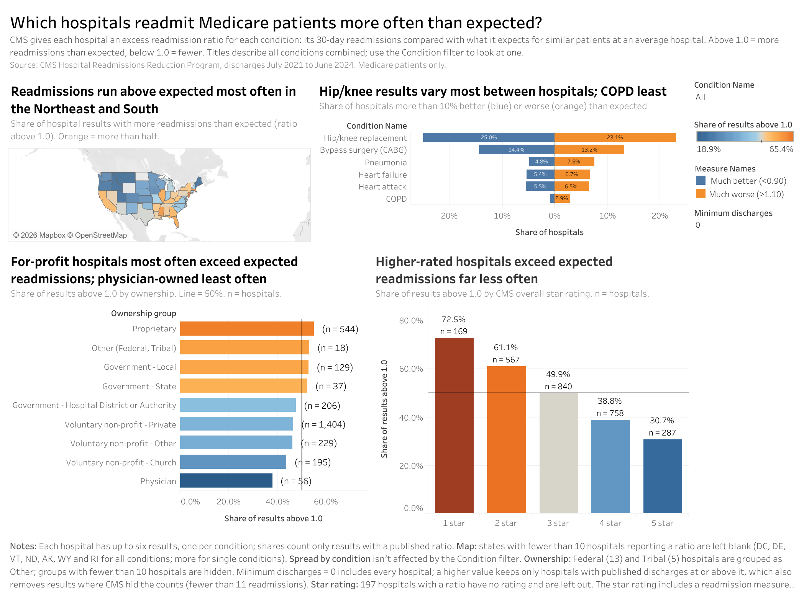
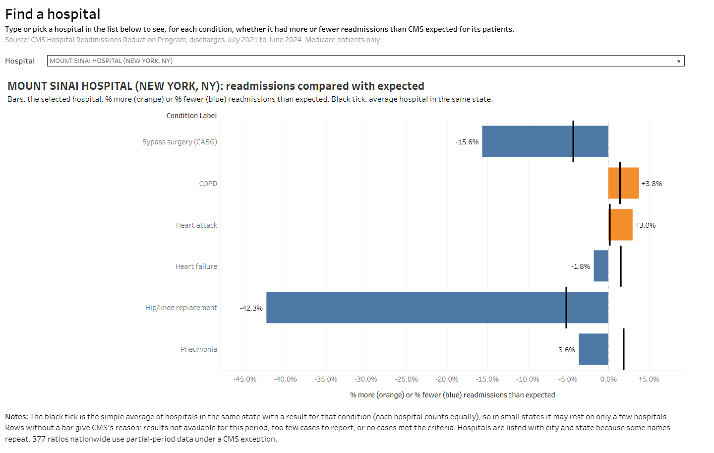

# Hospital Readmissions Dashboard

Which hospitals, states and ownership types readmit Medicare patients more often than expected, for which conditions, and do higher-rated hospitals readmit fewer patients?

**[View the interactive dashboard on Tableau Public](https://public.tableau.com/app/profile/vikram.kaushik3019/viz/HospitalReadmissions_17924318810080/NationalPicture)**



This project takes two public CMS datasets through a Python cleaning step, a MySQL database and SQL analysis, and ends in a two-page Tableau Public dashboard: a national overview and a lookup for any of 3,035 hospitals.

## Key findings

The measure is CMS's **excess readmission ratio**: a hospital's 30-day readmissions for a condition compared with what CMS expects for similar patients at an average hospital. Above 1.0 means more readmissions than expected.

1. **Nationally it is close to a coin flip.** 48.1% of the 11,681 hospital-condition results with a ratio are above 1.0. CMS calibrates "expected" so that the national picture centres on 1.0, so the useful comparisons are between groups.
2. **States vary much more than conditions.** The share of results above 1.0 runs from 65.4% in New Jersey and 63% in Massachusetts down to 18.9% in Montana. High-share states cluster in the Northeast and South, and low ones in the Mountain West and Northwest.
3. **Conditions differ in spread, not in level.** All six conditions average about 1.00, but hip/knee replacement results vary three times as much as COPD results (standard deviation 0.156 vs 0.046). 23.1% of hospitals are more than 10% worse than expected for hip/knee, compared with 2.9% for COPD.
4. **For-profit hospitals exceed expected readmissions most often, physician-owned hospitals least often.** 54.9% of proprietary hospital results are above 1.0 (544 hospitals), compared with 46.5% for private non-profits (1,404 hospitals) and 37.9% for physician-owned hospitals (56 hospitals).
5. **Higher star ratings go with fewer excess readmissions.** 72.5% of results at 1-star hospitals are above 1.0 (169 hospitals), falling step by step to 30.7% at 5 stars (287 hospitals). Part of this link is built in, because the overall star rating includes a readmission measure.
6. **The best hip/knee results come from specialty hospitals.** Among hospitals with at least 100 hip/knee discharges, 7 of the 10 lowest ratios belong to high-volume orthopaedic or surgical specialty hospitals, 4 of them physician-owned, which probably drives finding 4. The 10 highest are all general hospitals with 101 to 292 discharges. Specialty and volume are mixed together here, so this doesn't show which one matters.

These are associations, not causes.

## Data

| Dataset | Source | Rows | Used for |
|---|---|---|---|
| [Hospital Readmissions Reduction Program](https://data.cms.gov/provider-data/dataset/9n3s-kdb3) (`9n3s-kdb3`) | CMS Provider Data Catalog | 18,330 (3,055 hospitals × 6 conditions) | Ratios, discharges, readmissions |
| [Hospital General Information](https://data.cms.gov/provider-data/dataset/xubh-q36u) (`xubh-q36u`) | CMS Provider Data Catalog | 5,419 (one per hospital) | Name, city, state, ownership, star rating |

- **Period:** discharges from July 1, 2021 to June 30, 2024 (the FY 2026 HRRP release). Both files were downloaded on October 17, 2026; the exact file versions and URLs are logged in `data/raw/download_log.json`.
- **Conditions:** heart attack, heart failure, pneumonia, COPD, bypass surgery (CABG) and hip/knee replacement.
- **Join:** the files are joined on `facility_id`, read as text because 559 of the 3,055 HRRP IDs start with 0. 3,035 of the 3,055 HRRP hospitals match. The 20 that don't have no name, state or ownership, so they are left out of the analysis.

## How it works

```
download_data.py   CMS metadata API → data/raw/*.csv (+ download_log.json)
       ↓
clean_data.py      text like "N/A" and "Too Few to Report" → NULL + flag columns,
                   checks that every missing ratio is explained by a CMS footnote
       ↓
build_database.py  sql/schema.sql → MySQL tables → loads data/clean/*.csv, checks row counts
       ↓
run_analysis.py    sql/06 view → sql/01–05 summaries → data/tableau/hospital_condition.csv
       ↓
Tableau Public     reads the CSV (Tableau Public can't connect to MySQL)
```

Rows CMS suppressed are kept and flagged rather than deleted (`has_ratio`, `volume_suppressed`, `partial_period`), so each chart decides what to include and the limitations below can give exact counts.

### Schema

```
hospitals (3,035 used)          readmissions (one row per hospital × condition)   conditions (6)
─────────────────────           ─────────────────────────────────────────────     ─────────────
facility_id  PK  ◄──────────── facility_id                       PK           ┌─► condition_id  PK
facility_name                   condition_id                      PK, FK ──────┘    measure_name
city_town, state                number_of_discharges, number_of_readmissions       condition_code
hospital_ownership              excess_readmission_ratio                            condition_name
hospital_overall_rating         predicted / expected_readmission_rate
emergency_services              footnote, footnote_text
                                has_ratio, volume_suppressed, partial_period
                                start_date, end_date
```

There is deliberately no foreign key from `readmissions` to `hospitals`, so the 20 unmatched HRRP hospitals stay in the database and can be counted.

### SQL

| File | What it answers | Techniques |
|---|---|---|
| `sql/01_condition_summary.sql` | Share above 1.0, average and spread per condition | Joins, aggregates |
| `sql/02_state_summary.sql` | Share above 1.0 per state, with a 10-hospital minimum | CTE |
| `sql/03_ownership_summary.sql` | Simple vs discharge-weighted averages by ownership | Weighted averages |
| `sql/04_star_rating_summary.sql` | Share above 1.0 by star rating | Joins, aggregates |
| `sql/05_best_worst_hospitals.sql` | Best and worst 10 hospitals per condition (100+ discharges) | CTE, `RANK() OVER (PARTITION BY …)` |
| `sql/06_v_hospital_condition.sql` | Flat view exported for Tableau | View |

## The dashboard

**National picture** (one condition filter for the page):

1. **State map:** share of results above 1.0 by state.
2. **Spread by condition:** share of hospitals more than 10% better or worse than expected for each condition. This replaced the planned "share above 1.0 by condition", because every condition sits at 47 to 50%.
3. **Ownership:** share above 1.0 by ownership group, with a minimum-discharges slider. Federal and Tribal hospitals are too few to show on their own, so they are combined as "Other (Federal, Tribal)".
4. **Star rating:** share above 1.0 by CMS overall star rating, with the hospital count on each bar.

**Find a hospital:** pick any hospital to see, for each condition, how many more or fewer readmissions it had than expected, next to the average hospital in its state. Where there's no result, the row gives CMS's reason.



## Limitations

- **One snapshot, not a trend.** The data covers a single three-year window (July 2021 to June 2024), so it can't show whether hospitals are improving.
- **Medicare patients only.** The measures describe Medicare fee-for-service patients, not everyone a hospital treats.
- **Missing results.** 6,529 of the 18,210 hospital-condition rows used have no ratio. CMS gives the reason in a footnote: too few cases, results not available for the period, or no cases met the criteria. These rows are left out of every share and average.
- **Hidden counts.** 3,668 results have a ratio but no published discharges or readmissions, because CMS hides the counts when a hospital has fewer than 11 readmissions for a condition. This isn't only small hospitals: it is tied to having few readmissions, so these results tend to have low ratios. Any minimum-discharges filter drops them all, which is why the Ownership chart's shares rise when the slider moves off 0.
- **Small groups are noisy.** States and ownership groups with fewer than 10 hospitals reporting a ratio are hidden, and hospitals are only ranked with at least 100 discharges. On the hospital lookup, the state average for small states rests on only a few hospitals.
- **Unrated hospitals.** 197 hospitals with a ratio have no CMS star rating and are left out of the star rating chart.
- **Partial-period data.** 377 ratios were calculated from partial-period data under a CMS-approved exception (footnote 29). They are kept and flagged. Two of them appear in the best/worst lists: Ascension St Vincent Evansville (hip/knee) and Kootenai Health (pneumonia).
- **Associations, not causes.** For example, a higher share above 1.0 for for-profit hospitals doesn't show that ownership causes it. Patient mix, volume and specialty all differ between groups.

## How to run it

You need Python 3.11 and MySQL 8.0 or later.

```bash
python -m venv .venv
.venv\Scripts\activate            # Windows; on macOS/Linux: source .venv/bin/activate
pip install -r requirements.txt
```

Create a `.env` file in the project folder (it is git-ignored) with a MySQL user that can create the database:

```
MYSQL_USER=your_user
MYSQL_PASSWORD=your_password
MYSQL_HOST=localhost              # optional
MYSQL_PORT=3306                   # optional
MYSQL_DATABASE=hospital_readmissions   # optional
```

Then run the scripts in order:

```bash
python scripts/download_data.py    # download the two CMS files
python scripts/explore_data.py     # optional: first look at the raw data
python scripts/build_database.py   # clean the data and (re)build the MySQL database
python scripts/run_analysis.py     # run the SQL and export data/tableau/hospital_condition.csv
```

Each script stops with an error if one of its checks fails. CMS refreshes these datasets, so a new download may give slightly different numbers from the ones above.

## Repository layout

```
scripts/            Python pipeline (download, explore, clean, build database, analysis)
sql/                schema.sql and the commented analysis queries 01–06
data/tableau/       hospital_condition.csv, the file the dashboard reads
data/raw, data/clean  created by the scripts (git-ignored, except download_log.json)
notes.md            working notes: data checks, decisions and how the numbers were reconciled with Tableau
images/             dashboard screenshots
```

## Acknowledgements

Claude by Anthropic was used to help write code and guide me through this project.
